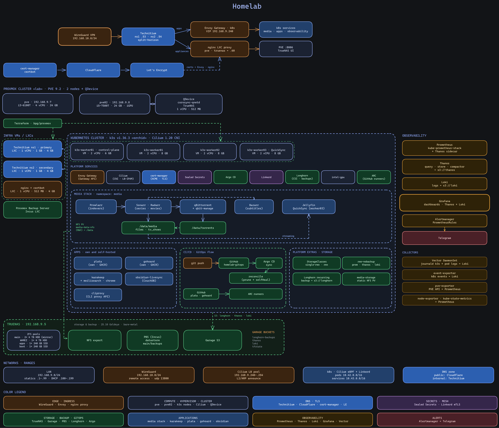

# Homelab

Infrastructure for my homelab: a two-node Proxmox cluster, a k3s cluster running on it and a
TrueNAS box for storage and backups. It is where I learn and test infrastructure, and where the
services I use day to day run.

This repository provisions and configures the machines. The applications inside the cluster are
deployed from [homelab-gitops](https://github.com/ramirocabral/homelab-gitops) by Argo CD.



## Hardware

| Machine | Hardware | Role |
| :--- | :--- | :--- |
| pve | Intel i3-6100T, 24 GB RAM, 500 GB SSD | Proxmox VE node |
| pve02 | Intel i5-7500T, 24 GB RAM, 500 GB NVMe | Proxmox VE node, iGPU passed to a k3s worker |
| NAS | AMD Ryzen 5 1600, 16 GB RAM, 3× 4 TB HDD, 240 GB SSD | TrueNAS SCALE |

## Services

### Platform

- **Proxmox VE**: two-node cluster, with a quorum device on the NAS.
- **k3s**: one control plane and three workers, all VMs.
- **Argo CD**: deploys everything in the cluster from Git.
- **Longhorn**: persistent volumes for the cluster.

### Network

- **Technitium**: internal DNS, two instances.
- **Envoy Gateway / nginx**: reverse proxies, with Let's Encrypt certificates.
- **WireGuard**: remote access.

### Monitoring

- **Prometheus, Thanos, Loki, Grafana**: metrics, logs and dashboards.
- **Alertmanager**: alerts to Telegram.

### Media and apps

- **Jellyfin**: media streaming, with hardware transcoding.
- **Sonarr, Radarr, Prowlarr, Bazarr, qBittorrent**: media automation.
- **Karakeep, Obsidian LiveSync**: bookmarks and note sync.

### Storage and backups

- **TrueNAS**: NFS share for the media library.
- **Garage**: S3 storage for volume backups, metrics, logs and Terraform state.
- **Proxmox Backup Server**: nightly backups of the VMs and containers.

## Network topology

```text
[ Internet ]
      │
      ▼
[ MikroTik ] ── WireGuard (remote access)
      │
      ├──> [ pve ]   ──> k3s nodes, DNS, reverse proxy
      ├──> [ pve02 ] ──> k3s nodes, DNS
      └──> [ NAS ]   ──> NFS, S3, backups, quorum device
```

## Repository structure

```text
lab/
├── terraform/   VMs and containers on Proxmox
├── ansible/     k3s bootstrap
├── scripts/     Helper scripts for the Proxmox nodes
├── proxy/       Reverse proxy for the services outside the cluster
└── docs/        Diagram
```
